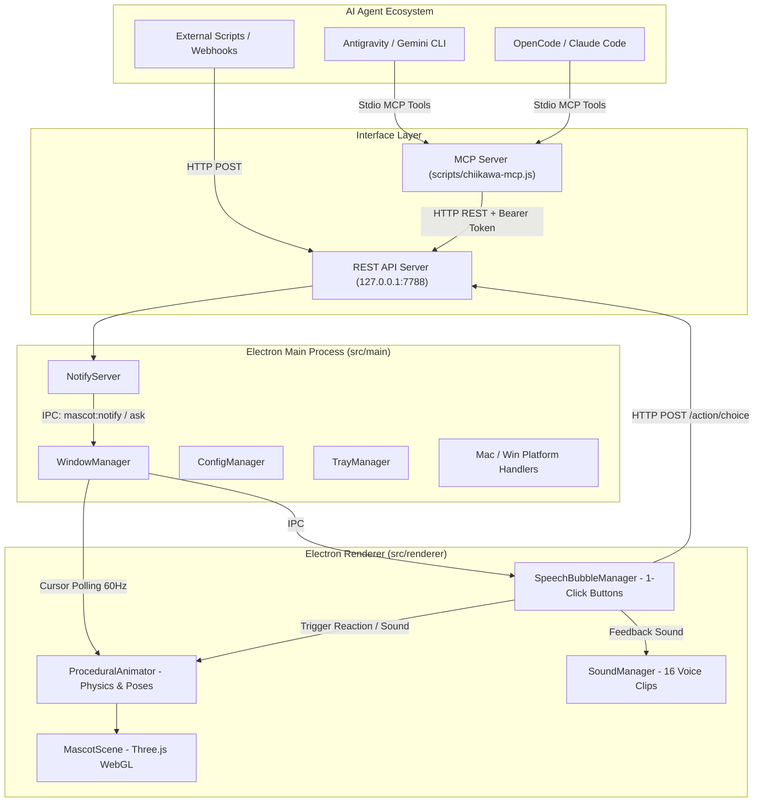

# 🐾 Chiikawa Companion — Comprehensive Project Handoff Context

> **Version**: `v1.0.8`  
> **Repository**: [https://github.com/wheddy123/chiikawa-companion](https://github.com/wheddy123/chiikawa-companion)  
> **Last Updated**: 2026-10-17  
> **Target OS**: macOS (Apple Silicon / Intel) & Windows 10/11  
> **Status**: Production-ready desk mascot with 3D animation, liquid physics, living telemetry rhythm, native Antigravity PreToolUse safety gate, and 1-click HITL decision buttons.

---

## 1. 📖 Project Overview & Purpose

**Chiikawa Companion** is an ultra-lightweight, high-framerate 3D desktop companion designed to sit on the user's screen (above the macOS Dock or Windows Taskbar) and act as a playful, expressive visual frontend for **AI Coding Agents** (such as Antigravity, OpenCode, Claude Code, Cursor, and Roo Code).

### Key Value Propositions
1. **Human-in-the-Loop (HITL) 1-Click Decisions**:
   Instead of cumbersome terminal dialogs or intrusive full-screen popups, agents prompt the user directly through Chiikawa's floating speech bubble with 1-click decision buttons (e.g. `Approve`, `Review`, `Reject`).
2. **Delightful 3D Presence**:
   A pristine 3D model of Chiikawa rendered at 60 FPS in Three.js with soft vinyl studio lighting, eyes tracking the mouse cursor, and expressive procedural animations (breathing, curious head tilt, joyful bouncing, trembling alert, sad slouch).
3. **Soft Squishy "Mochi" Drag Physics**:
   Chiikawa can be picked up and dragged anywhere on the screen with gentle volume-preserving stretch, inertia tilt, relaxing dangling sways, and jello spring landings.
4. **Authentic Voice Lines**:
   16 curated community soundboard clips (Usagi, Chiikawa, Hachiware, Momonga) playing at a pleasant, non-startling volume (`0.20`).
5. **Universal Agent Integration**:
   Built-in Model Context Protocol (MCP) server (`scripts/chiikawa-mcp.js`) and local REST API (`127.0.0.1:7788`) with Bearer token authentication.

---

## 2. 🏗 Architecture & Tech Stack



### Technology Breakdown
- **Runtime**: Electron `^34.3.0`, Node.js `20+`
- **Frontend / 3D**: Three.js `^0.174.0`, HTML5 WebGL Canvas, CSS3 Backdrop Blur
- **Bundler / Build**: Vite `^6.2.0` (Renderer), esbuild `^0.25.0` (Main & Preload), Swift Native (`raycast-watcher`)
- **Type Safety**: TypeScript `^5.8.2` (strict mode across entire codebase)

---

## 3. 🎯 Key Modules & Directory Structure

```
chiikaưa/
├── assets/
│   ├── chiikawa.glb            # Pristine original 3D model (251 KB)
│   ├── sounds/                 # 16 authentic MP3 voice clips
│   │   ├── usagi_una.mp3
│   │   ├── usagi_yaha.mp3
│   │   ├── nani_nani.mp3
│   │   └── ...
│   └── voice_lines.json        # Sound catalog metadata
├── scripts/
│   ├── build-native.js         # Compiles Swift raycast-watcher on macOS
│   ├── chiikawa-mcp.js         # Production MCP Server (Stdio protocol)
│   ├── chiikawa-notify.sh      # Bash CLI helper for notifications & questions
│   └── chiikawa-notify.ps1     # PowerShell CLI helper for Windows
├── src/
│   ├── types.ts                # Shared TypeScript schemas & interfaces
│   ├── main/
│   │   ├── index.ts            # Application bootstrap & lifecycle
│   │   ├── config.ts           # JSON config manager with crypto token
│   │   ├── window.ts           # BrowserWindow creation, IPC, cursor polling (60Hz)
│   │   ├── server.ts           # HTTP REST API server with rate limiting
│   │   ├── tray.ts             # OS System Tray / Menu Bar icon & context menu
│   │   └── platform/
│   │       ├── mac.ts          # macOS positioning, dock hiding, screen saver level
│   │       ├── win.ts          # Windows taskbar alignment
│   │       └── raycast-watcher.swift # Native Swift window observer
│   ├── preload/
│   │   └── index.ts            # Context-isolated secure IPC bridge (ElectronAPI)
│   └── renderer/
│       ├── index.html          # Canvas & bubble container DOM layout
│       ├── style.css           # Glassmorphism styling, bubble pop animations
│       ├── index.ts            # Main renderer controller & full-screen drag loop
│       ├── scene.ts            # Three.js camera, lights, model loading, raycasting
│       ├── animation.ts        # Procedural poses, mochi squish, inertia damping
│       ├── bubble.ts           # SpeechBubbleManager with 1-click option buttons
│       └── audio.ts            # SoundManager with cache & volume regulation (0.20)
└── dist/                       # Production build outputs
```

---

## 4. 🛠 Critical Bug Resolutions & Engineering Lessons

### 1. The 3D Model Deformation & Disappearing Feet (`v1.0.4` -> `v1.0.5`)
- **Problem**: When attempting to create a seated pose, vertices were algorithmically rotated around the waist in a script (`chiikawa_sitting.glb`). Because the raw mesh has no skeletal armature, this crushed the legs, truncated the feet, and left Chiikawa looking like a giant distorted head stump.
- **Root Cause & Fix**:
  - Reverted permanently to the pristine original `assets/chiikawa.glb`.
  - Removed all deformed files.
  - In [scene.ts](file:///Users/wheddy/Desktop/chiikaưa/src/renderer/scene.ts#L36-L42), angled the camera slightly downwards (`camera.position(0, 0.20, 5.0)`, `lookAt(0, -0.30, 0)`), scaled `targetHeight = 1.68`, and anchored at `initialPos.y = -1.30`.
  - **Result**: Chiikawa's two tiny feet rest cleanly above the screen border (~28px padding), fully visible with no clipping.

### 2. Chaotic Drag Jitter (`v1.0.4` -> `v1.0.5`)
- **Problem**: Dragging Chiikawa caused violent high-frequency vibration and spastic stretching.
- **Root Cause & Fix**:
  - Code had frantic sine waves (`sin(t * 28.0) * 0.12`, `abs(sin(t * 22)) * 0.07`).
  - Replaced with soft, volume-preserving mochi dough physics in [animation.ts](file:///Users/wheddy/Desktop/chiikaưa/src/renderer/animation.ts#L148-L180):
    - Stretch capped at +3% to +11% based on speed (`1 / sqrt(stretch)` for volume conservation).
    - Inertia tilt filtered with exponential dampening (`exp(-12t)`).
    - Relaxed pendulum sway (~6Hz) while airborne.
    - Soft jello spring rebound (`exp(-9t)`) that settles within 0.4 seconds upon landing.

### 3. Drag Freezing / Mouse Capture Drop (`v1.0.5` -> `v1.0.6`)
- **Problem**: Dragging Chiikawa across the desktop caused it to abruptly freeze after moving only 50–80 pixels.
- **Root Cause & Fix**:
  - Every frame, `updateHitTest` was checking if the cursor was over the 3D mesh. When the user dragged quickly, the cursor briefly stepped 1px off the mesh, triggering `setIgnoreMouseEvents(true)`. The window immediately dropped all mouse events to the desktop beneath, killing the drag!
  - In [index.ts](file:///Users/wheddy/Desktop/chiikaưa/src/renderer/index.ts#L85-L95), locked mouse capture during drag: `if (isDragging) return;` inside `updateHitTest`.

### 4. macOS Menu Bar Ceiling Clamp (`v1.0.6` -> `v1.0.7`)
- **Problem**: Chiikawa could not be dragged into the top half of the screen; it was blocked ~195px below the top of the monitor.
- **Root Cause & Fix**:
  - The window is 320px tall (top 120px is transparent speech bubble space, bottom 200px is Chiikawa).
  - macOS AppKit clamps standard `NSWindow` frames so the top edge cannot exceed `y >= 25` (the macOS Menu Bar). Because the invisible bubble hit the menu bar ceiling, Chiikawa at the bottom stopped at `25 + 170 = 195px`!
  - In [window.ts](file:///Users/wheddy/Desktop/chiikaưa/src/main/window.ts#L27-L32), added `enableLargerThanScreen: true` to `BrowserWindow`.
  - In `window:move-to`, switched from `setPosition` to `setBounds`, permitting negative coordinates.
  - In [index.ts](file:///Users/wheddy/Desktop/chiikaưa/src/renderer/index.ts#L168-L175), switched to exact client-relative grab offsets: `dragGrabOffsetX = e.clientX`, `dragGrabOffsetY = e.clientY`.
  - **Result**: Chiikawa can now be dragged to the very top edge of the screen, over the menu bar, into any monitor, without boundaries.

---

## 5. 🔌 Integration APIs & Protocols

### Local HTTP Endpoints (`http://127.0.0.1:7788`)

All requests require the `Authorization: Bearer <token>` header (found in `chiikawa-config.json`).

| Endpoint | Method | Payload / Arguments | Description |
|---|---|---|---|
| `/health` | `GET` | None | Returns `{ "ok": true, "platform": "darwin" }`. |
| `/notify` | `POST` | `{ message, state, sound, duration_ms }` | Pops an informational speech bubble with audio. |
| `/ask` | `POST` | `{ question, options: [{id, label, style, sound}], timeout_ms }` | Displays 1-click decision buttons; blocks until human clicks or times out. |
| `/telemetry` | `GET` | None (Bearer token) | Returns real-time `{ cpuUsagePercent, memUsagePercent, loadAvg, cores }`. |
| `/action/choice`| `POST` | `{ id, label, questionId, timestamp }` | Internal/external webhook to submit a decision. |
| `/choice` | `GET` | `?questionId=...` | Polls for user decision if not using blocking `/ask`. |
| `/play-sound` | `POST` | `{ clip: "usagi_yaha" }` | Directly plays any authentic voice clip. |

#### Example: Asking a Human Decision from Bash
```bash
TOKEN=$(node -e 'console.log(JSON.parse(require("fs").readFileSync(require("os").homedir() + "/Library/Application Support/chiikawa-companion/chiikawa-config.json")).token)')

curl -s -X POST http://127.0.0.1:7788/ask \
  -H "Authorization: Bearer $TOKEN" \
  -H "Content-Type: application/json" \
  -d '{
    "question": "Deploy release v1.0.8 to production?",
    "state": "thinking",
    "sound": "nani_nani",
    "options": [
      { "id": "yes", "label": "Deploy Now 🚀", "style": "primary", "sound": "task_complete" },
      { "id": "no", "label": "Cancel ❌", "style": "danger", "sound": "attention_surprise" }
    ]
  }'
```

### 5.2 🫀 Living Mascot Telemetry (Feature A)
Chiikawa phản ánh nhịp tim và trạng thái phần cứng của máy tính trong thời gian thực:
- **Sampling Engine** (`src/main/telemetry.ts`): Lấy mẫu `os.cpus()`, `os.freemem()`, `os.loadavg()` định kỳ 2000ms với overhead cực nhẹ (< 0.05ms).
- **IPC Broadcast**: Main process gửi kênh `mascot:telemetry` tới Renderer.
- **Rhythmic Modulation** (`src/renderer/animation.ts`):
  - **Tần số thở (Breathing Frequency)**: Chuyển mượt từ `1.2 Hz` (khi CPU nhàn rỗi < 10%) lên đến `3.8 Hz` (khi CPU tải nặng > 80%).
  - **Biên độ nhấp nhô (Amplitude)**: Tăng từ `0.025` lên `0.065`, mascot nhấp nhô rõ rệt như đang thở dốc khi máy tính đang build code hoặc chạy mô hình AI.
  - **Nhịp thở hổn hển & run rẩy**: Khi CPU > 75%, Chiikawa kích hoạt bước nhảy thở dốc nhẹ (`panting hop`); khi RAM > 90%, cơ thể mascot run rẩy nhẹ cảnh báo áp lực bộ nhớ.

### 5.3 🛡️ Native PreToolUse Safety Gate (Feature B)
Tích hợp trực tiếp với Antigravity CLI Lifecycle Hooks (`.agents/hooks.json` và `.agents/scripts/safety-gate.js`):
- **Cơ chế hoạt động**: Khi Antigravity CLI chuẩn bị thực thi lệnh qua `run_command`, hook script chặn trước ở tầng runtime.
- **Kiểm duyệt lệnh phá hoại**: Quét regex các mẫu lệnh nguy hiểm như `rm -rf`, `git reset --hard`, `git push --force`, `mkfs`, `dd of=/dev`, `fdisk`, `chmod 777 /`,...
- **Interactive Authorization**:
  - Tự động gọi `POST http://127.0.0.1:7788/ask` sang Chiikawa.
  - Chiikawa trên màn hình lập tức phát âm thanh `nani_nani`, rung lắc cảnh báo và hiển thị câu hỏi kèm 2 nút: `Cho phép (Authorize) 🚀` và `Chặn lại (Block) 🛡️`.
  - Nếu Operator bấm cho phép -> Trả về `{"decision": "allow"}` cho Antigravity tiếp tục.
  - Nếu Operator bấm từ chối hoặc hết 30s -> Trả về `{"decision": "deny"}` chặn đứng lệnh ngay lập tức!
  - Nếu Chiikawa Mascot offline -> Tự động fallback sang cơ chế `{"decision": "force_ask"}` native của Antigravity CLI.

### 5.4 ⌨️ Typewriter Streaming for Speech Bubble (Feature C Blueprint)
Kiến trúc luồng phản hồi văn bản thời gian thực (real-time token streaming) kết hợp hoạt ảnh đồng bộ:
- **Khái niệm**: Thay vì hiển thị toàn bộ đoạn văn bản dài một cách đột ngột khi agent hoàn thành câu trả lời, speech bubble hiển thị chữ chạy từng ký tự/từng từ mượt mà (typewriter effect) kèm con trỏ nhấp nháy (`▌`).
- **Head Bob & Lip Sync Procedural**: Khi text đang được stream vào bubble, Chiikawa thực hiện các nhịp gật đầu nhẹ (`head tilt` và `lip sync hop`) ở tần số 8–10Hz theo tốc độ ký tự, tạo cảm giác Chiikawa thực sự đang "nói" từng lời với Operator.
- **Thanh năng lượng tiến trình (Agent Progress Gauge)**: Dải màu mỏng hiển thị phần trăm tiến độ tác vụ dưới chân bong bóng thoại.

### 5.5 Model Context Protocol (MCP) Configuration
In Antigravity (`~/.gemini/antigravity-cli/config.json`) or Claude Desktop (`claude_desktop_config.json`):

```json
{
  "mcpServers": {
    "chiikawa": {
      "command": "node",
      "args": ["/Users/wheddy/Desktop/chiikaưa/scripts/chiikawa-mcp.js"]
    }
  }
}
```

Exposed MCP Tools:
- `chiikawa_notify`: Send a notification bubble.
- `chiikawa_ask`: Prompt the user with 1-click decision options and wait for their choice.
- `chiikawa_play_sound`: Play a specific Chiikawa character sound.
- `chiikawa_get_user_choice`: Retrieve the latest user choice.

---

## 6. 🎵 Voice Lines Catalog (`volume: 0.20`)

| ID | Character | Label | Best Used For |
|---|---|---|---|
| `usagi_una` | Usagi | Una | Agent startup, task received |
| `usagi_yaha` | Usagi | Yaha / Yahaaaa | Task complete, success, approved |
| `usagi_una_na_yaha` | Usagi | U-una-na-ya-ha | Heavy computation, busy |
| `usagi_huh` | Usagi | Huh | Clarification needed, unexpected diff |
| `usagi_haaa` | Usagi | Haaaa?! | Warning, exception, rejected |
| `usagi_wula` | Usagi | Wula! | Notification ping |
| `hachiware_oi` | Hachiware | Oi | User attention requested |
| `momonga_silly` | Momonga | Silly noise | Idle random hop |
| `momonga_crying` | Momonga | Crying | Error state |
| `nani_nani` | Chiikawa | Nani nani? | Question prompt, options presented |
| `una_yaha_curry` | Usagi | Una yaha - curry | Easter egg click reaction |
| `usagi_iyaha` | Usagi | IYAHA | High-energy click reaction |

---

## 7. 🚀 Running & Developing

### Commands
```bash
# Install dependencies
npm install

# Full build (Main, Preload, Renderer, Native Swift)
npm run build

# Run app in foreground
npx electron .

# Run in background (Daemon mode)
nohup npx electron . > /dev/null 2>&1 &
```

### Configuration Location
- **macOS**: `~/Library/Application Support/chiikawa-companion/chiikawa-config.json`
- **Windows**: `%APPDATA%\chiikawa-companion\chiikawa-config.json`

---

## 8. 📋 Next Steps & Future Enhancements

1. **Multi-Selection Checkbox Support**:
   For complex agent tasks requiring multiple options selected before submitting (e.g., selecting files to commit).
2. **Adaptive Bubble Inversion**:
   When Chiikawa is dragged near the very top of the screen (`y < 150`), invert the speech bubble downward instead of upward to prevent the bubble from clipping off the top edge.
3. **Stand-Alone Installers**:
   Generate signed `.dmg` for macOS (Apple Silicon + Intel universal) and `.exe` for Windows using `npm run dist`.
