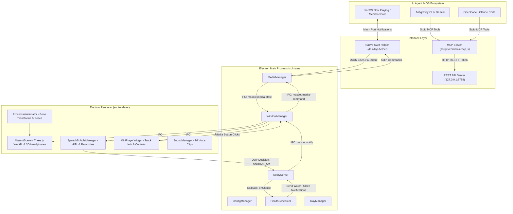

# 🐾 Chiikawa AI (c.ai) — Comprehensive Project Handoff Context

> **Version**: `v1.4.0` — **"Health & Harmony Update"** (Lofi Vibes, Health Scheduler & 3D Headphones)  
> **Repository**: [https://github.com/wheddy123/chiikawa-companion](https://github.com/wheddy123/chiikawa-companion)  
> **Last Updated**: 2026-10-19  
> **Target OS**: macOS (Apple Silicon / Intel) & Windows 10/11  
> **Status**: Production release `v1.4.0` with Articulated Rigging (8 bones), Health Scheduler (Water reminder + 22:30 Sleep alert with strict 5m snooze loop), macOS Native Media Engine (`MRMediaRemote` Now Playing & Controls), Procedural 3D Headphones with reactive pop-in/pop-out scale animation, Mini-Player translucent glassmorphism widget, double-click mute toggle, calibrated mouth anchor bandaid, speech bubble system, and comprehensive verification suite (`npm run verify`).

---

## 1. 📖 Project Overview & Purpose

**Chiikawa AI (c.ai)** is an ultra-lightweight, high-framerate 3D desktop companion designed to sit on the user's screen (above the macOS Dock or Windows Taskbar) and act as a playful, expressive visual frontend and lifestyle assistant for **AI Coding Agents** (such as Antigravity, OpenCode, Claude Code, Cursor, and Roo Code) as well as the Operator's daily workflow.

### Key Value Propositions
1. **Human-in-the-Loop (HITL) 1-Click Decisions**:
   Instead of cumbersome terminal dialogs or intrusive full-screen popups, agents prompt the user directly through Chiikawa's floating speech bubble with 1-click decision buttons (e.g. `Approve`, `Review`, `Reject`).
2. **Health & Wellness Scheduler (New in v1.4.0)**:
   Proactive reminders for the Operator: periodic hydration alerts with 1-click acknowledgment (`Đã uống 💧`) and evening sleep alerts (`22:30`) with an infinite 5-minute snooze loop (`Cố thêm 5 phút ⏰`) until the user decides to sleep (`Đi ngủ luôn 🛌`).
3. **OS Media Integration & 3D Headphones (New in v1.4.0)**:
   Real-time macOS Now Playing tracking via lightweight private native Swift helper (`MRMediaRemote`), displaying track metadata in a floating translucent Mini-Player with playback controls (`[⏮] [⏯] [⏭]`). Procedural Three.js 3D headphones dynamically pop onto Chiikawa's head when music is playing and pop off when paused.
4. **Articulated 8-Bone Skeletal Presence**:
   A rigged 3D model of Chiikawa rendered at 60 FPS in Three.js with soft vinyl studio lighting, eyes tracking the mouse cursor, and expressive procedural animations (breathing, shy glance, ear twitches, sit-down plushie pose, head petting reaction, dangling drag flail, and jello rebound).
5. **Authentic Voice Lines**:
   16 curated community soundboard clips (Usagi, Chiikawa, Hachiware, Momonga) playing at a pleasant, non-startling volume (`0.20`), with instant audio cut on mute.
6. **Universal Agent Integration**:
   Built-in Model Context Protocol (MCP) server (`scripts/chiikawa-mcp.js`) and local REST API (`127.0.0.1:7788`) with Bearer token authentication.

> [!NOTE]
> **Về việc định danh phiên bản v1.4.0 (thay vì v2.0)**:  
> Bản cập nhật này tập trung hoàn thiện trải nghiệm desktop thường nhật (tiện ích sức khỏe, âm nhạc, visual headphones và độ bền bỉ kiểm thử). Phiên bản mang tính bước ngoặt **v2.0** sẽ được dành cho đột phá kiến trúc tiếp theo (như Mascot Autonomous Brain, Local LLM Co-Pilot, hoặc Proactive Long-Term Memory).

---

## 2. 📅 Release History & Changelog

### 🎧 v1.4.0 — "Health & Harmony Update" (2026-10-19)
- **Health Scheduler (`src/main/scheduler.ts`)**:
  - `Water Reminder`: Định kỳ (mặc định 45 phút) gửi bong bóng thoại tương tác `Uống nước đi sếp! 💧` kèm nút `Đã uống 💧`. Bấm nút sẽ reset chu kỳ đếm giờ.
  - `Sleep Reminder`: Kiểm tra target time (mặc định `22:30`), kích hoạt bong bóng cảnh báo `Đến giờ đi ngủ rồi sếp ơi! 🌙` kèm 2 lựa chọn:
    - `Cố thêm 5 phút ⏰`: Hoãn báo thức đúng **300.000 ms (5 phút)** bằng `setTimeout`, sau đó lặp lại thông báo cho đến khi người dùng đi ngủ.
    - `Đi ngủ luôn 🛌`: Tắt thông báo ngủ trong ngày (reset lại vào trưa hôm sau) và gửi lời chúc ngủ ngon `Chúc sếp ngủ thật ngon nha! ✨🐾`.
- **OS Media Integration (`src/main/platform/desktop-helper.swift`, `src/main/media.ts`)**:
  - Thay thế observer cũ bằng `desktop-helper.swift` tích hợp `MRMediaRemote` của macOS (thông qua `dlopen` PrivateFrameworks).
  - Không phụ thuộc vào npm package bên ngoài nặng nề (`active-win`). Tự động phát hiện khi Brave, Chrome, Safari, Music, Spotify phát nhạc.
  - Hỗ trợ lệnh điều khiển playback (`play_pause`, `next`, `prev`) gửi qua stdin của helper và fallback qua phím media hệ thống.
- **Tai nghe 3D Headphones (`src/renderer/scene.ts`)**:
  - Tạo mô hình 3D thủ công bằng Three.js geometries theo đúng reference art: Vòm xanh dương (`#4A90E2`), đệm tai donut đen (`#1E1E1E`), nút bán cầu vàng (`#F5A623`).
  - Gắn trực tiếp vào xương đầu (`bones.head`) nên tai nghe xoay/lắc tự nhiên theo từng biểu cảm của Chiikawa mà không sợ lỗi chia ma trận (zero-determinant division by zero fix).
  - Hiệu ứng Scale Animation: Tự động pop-in trong 0.5s khi nhạc phát (`isPlaying: true`) và pop-out mượt mà khi dừng nhạc.
- **Mini-Player Glassmorphism UI (`src/renderer/index.html`, `style.css`)**:
  - Widget nổi mờ dạng viên thuốc bo tròn trên đầu mascot: Icon nốt nhạc nhấp nháy, tiêu đề bài hát & nghệ sĩ chạy chữ, 3 nút bấm tương tác `[⏮] [⏯] [⏭]`.
- **Verification Gate & Hardening**:
  - Tích hợp `npm run typecheck` (`tsc --noEmit`).
  - Script kiểm tra chất lượng 1 lệnh `npm run verify` (`scripts/verify_all.sh`): TypeScript, Build, Gesture State Machine, Secrets Guard, E2E Mute Sequence.

### 🦴 v1.3.0 — "Rigging & Articulated Mascot" (2026-10-18)
- Gắn xương armature 8 bones cho Chiikawa (`Chiikawa_Skeleton`): `head`, `body`, `earL`, `earR`, `handL`, `handR`, `footL`, `footR`.
- Tư thế ngồi plushie hướng 2 chân về phía trước sau 15s không hoạt động.
- Shy glance liếc trộm chuột (cooldown 22s), ngoáy tai ngẫu nhiên, vung tay chân khi bị nhấc bổng (`drag flail`), và phản ứng nựng đầu (`head petting`).
- Đổi tên sản phẩm sang **Chiikawa AI (c.ai)**, thiết kế lại icon Menu Bar trong suốt và background DMG.

### 🩹 v1.0.9 — "Foundational Desktop Release" (2026-10-17)
- Cố định miếng băng dán miệng (`bandaidMesh`) vào đúng tọa độ miệng (`MOUTH_ANCHOR`).
- Cơ chế double-click bật/tắt mute với khả năng ngắt âm thanh tức thì (`SoundManager.stopAll`).
- Hệ thống bong bóng thoại đa năng: Thanh đếm lùi thời gian, badge tác vụ `AGENT` / `OC` / `!?`, hiệu ứng shimmer khi đang suy nghĩ (`thinking`).
- Tích hợp Living Mascot Telemetry (`src/main/telemetry.ts`) và Antigravity Safety Gate Hook.

---

## 3. 🏗 Architecture & Tech Stack



### Technology Breakdown
- **Runtime**: Electron `^34.3.0`, Node.js `20+`
- **Frontend / 3D**: Three.js `^0.174.0`, HTML5 WebGL Canvas, CSS3 Glassmorphism Backdrop Filter
- **Bundler / Build**: Vite `^6.2.0` (Renderer), esbuild `^0.25.0` (Main & Preload), Swift Native (`swiftc -O`)
- **Native OS Bridge**: macOS `MRMediaRemote.framework` (private), AppKit `NSWorkspace`
- **Type Safety**: TypeScript `^5.8.2` (strict mode with 0 type errors across whole project)

---

## 4. 🎯 Key Modules & Directory Structure

```
chiikaưa/
├── assets/
│   ├── chiikawa.glb            # Pristine original 3D model
│   ├── chiikawa_rigged.glb     # 8-bone articulated skinned mesh
│   ├── bandaid.png             # Mute band-aid texture
│   ├── sounds/                 # 16 authentic MP3 voice clips
│   └── voice_lines.json        # Sound catalog metadata
├── scripts/
│   ├── build-native.js         # Compiles Swift desktop-helper binary
│   ├── cai-api.sh              # Zero-leak Bearer token API curl helper
│   ├── snap.sh                 # Headless screenshot evidence generator
│   ├── test_gesture.mjs        # Unit tests for double-click state machine
│   ├── test_double_click_sequence.py # Live E2E alternating mute tests
│   ├── guard_secrets.sh        # Pre-commit secrets scanner
│   ├── verify_all.sh           # Main CI/Verification gate script
│   └── chiikawa-mcp.js         # Production MCP Server (Stdio)
├── src/
│   ├── types/
│   │   └── index.ts            # Shared TypeScript schemas & interfaces
│   ├── main/
│   │   ├── index.ts            # Application bootstrap & lifecycle
│   │   ├── config.ts           # JSON config manager (water, sleep, media, token)
│   │   ├── scheduler.ts        # HealthScheduler (Water interval & Sleep snooze loop)
│   │   ├── media.ts            # MediaManager (Now Playing stream & IPC routing)
│   │   ├── window.ts           # BrowserWindow creation, hit testing, cursor polling (60Hz)
│   │   ├── server.ts           # HTTP REST API server with rate limiting
│   │   ├── tray.ts             # OS System Tray icon & context menu
│   │   └── platform/
│   │       ├── desktop-helper.swift # Native Swift MediaRemote + Raycast observer
│   │       ├── mac.ts          # macOS positioning, dock hiding
│   │       └── win.ts          # Windows taskbar alignment
│   ├── preload/
│   │   └── index.ts            # Context-isolated secure IPC bridge (electronAPI)
│   └── renderer/
│       ├── index.html          # Canvas, speech bubble & mini-player widget DOM
│       ├── style.css           # Glassmorphism styling & animations
│       ├── index.ts            # Renderer controller, dragging & hit-testing
│       ├── scene.ts            # Three.js scene, procedural 3D headphones, bandaid
│       ├── animation.ts        # Bone poses, physics, squish, petting reaction
│       ├── bubble.ts           # SpeechBubbleManager with interactive buttons
│       └── audio.ts            # SoundManager with cache & volume regulation (0.20)
└── dist/                       # Production build outputs
```

---

## 5. 🔌 Integration APIs & Protocols

### Local HTTP Endpoints (`http://127.0.0.1:7788`)
All requests require the `Authorization: Bearer <token>` header (found in `chiikawa-config.json`).

| Endpoint | Method | Payload / Arguments | Description |
|---|---|---|---|
| `/health` | `GET` | None | Trả về `{ "ok": true, "platform": "darwin" }` (không cần token). |
| `/notify` | `POST` | `{ message, state, sound, duration_ms, options, sticky }` | Hiển thị bong bóng thoại kèm nút bấm tương tác. |
| `/ask` | `POST` | `{ question, options: [{id, label, style, sound}], timeout_ms }` | Hiển thị câu hỏi 1-click; block chờ người dùng chọn. |
| `/action/choice`| `POST` | `{ id, label, questionId }` | Gửi lựa chọn người dùng (vd: `water_drank`, `sleep_now`, `snooze_5m`). |
| `/choice` | `GET` | `?questionId=...` | Lấy lựa chọn tiếp theo đang chờ trong hàng đợi. |
| `/telemetry` | `GET` | None | Trả về thông số hệ thống CPU, RAM, loadAvg. |
| `/play-sound` | `POST` | `{ clip: "usagi_yaha" }` | Phát trực tiếp âm thanh từ catalog. |
| `/debug/state` | `GET` | None | Lấy toàn bộ trạng thái render, tọa độ mascot, camera, bandaid, headphones. |
| `/debug/eval` | `POST` | `{ code: "..." }` | Thực thi mã JavaScript trong renderer để kiểm thử (chỉ bật khi `CHIIKAWA_DEBUG=1`). |

---

## 6. ⚙️ Configuration Schema

Vị trí lưu file cấu hình:
- **macOS**: `~/Library/Application Support/chiikawa-ai/chiikawa-config.json` (fallback: `chiikawa-companion`)
- **Windows**: `%APPDATA%\chiikawa-ai\chiikawa-config.json`

```json
{
  "port": 7788,
  "token": "cai_sec_...",
  "soundEnabled": true,
  "windowWidth": 280,
  "windowHeight": 200,
  "waterIntervalMin": 45,
  "sleepTargetTime": "22:30",
  "mediaEnabled": true,
  "macNotificationPosition": "bottom-right"
}
```

---

## 7. 🧪 Testing & Verification Guide

Dự án áp dụng nguyên tắc **"Three-Strike Rule"** và **Verification Gate**:
Không coi một thay đổi là hoàn tất nếu chỉ "biên dịch được". Mọi thay đổi phải đi kèm file bằng chứng snapshot và log định lượng.

Chạy toàn bộ cổng kiểm thử chỉ với một lệnh:
```bash
npm run verify
```

Quy trình bao gồm 5 bước nghiêm ngặt:
1. **TypeScript Typecheck**: `tsc --noEmit -p tsconfig.json` (Đảm bảo 0 lỗi kiểu dữ liệu).
2. **Build Pipeline**: Biên dịch đồng thời Main, Preload, Renderer (Vite) và Swift native helper.
3. **Gesture Unit Tests**: Kiểm tra máy trạng thái Double-click, Single-click, Drag, Triple-click.
4. **Secrets Guard**: Quét toàn bộ repository ngăn chặn lộ Bearer token bí mật.
5. **E2E Live Tests**: Thử nghiệm chuỗi 6 lần double-click bật/tắt mute luân phiên trên server thực và kiểm tra đồng bộ bandaidMesh.

---

## 8. 📸 Evidence Snapshots Index (`/tmp/chiikawa-evidence/`)

| File Snapshot | Mô tả & Tính năng được chứng minh |
|---|---|
| `22_headphones_fresh_fit_...png` | Tai nghe 3D Headphones gắn khớp hoàn hảo trên đầu Chiikawa khi đang phát nhạc. |
| `23_headphones_popped_out_...png` | Tai nghe thu nhỏ và ẩn mượt mà sau khi nhạc dừng phát. |
| `24_media_player_widget_active_...png` | Mini-Player widget dạng kính mờ hiển thị tiêu đề, nghệ sĩ và các nút điều khiển. |
| `25_sleep_alert_bubble_...png` | Bong bóng thoại cảnh báo đi ngủ lúc 22:30 với 2 nút "Đi ngủ luôn" và "Cố thêm 5 phút". |
| `28_water_reminder_bubble_...png` | Bong bóng nhắc nhở uống nước với nút "Đã uống 💧". |
| `07_p3_dblclick_muted_on_...png` | Miếng dán bandaid hiển thị che miệng chính xác khi chuyển sang chế độ Mute. |
| `08_p3_dblclick_muted_off_...png` | Miếng dán biến mất khi bật lại âm thanh. |

---

## 9. 🚀 Running & Developing

```bash
# Cài đặt dependencies
npm install

# Kiểm tra kiểu dữ liệu
npm run typecheck

# Build toàn bộ hệ thống
npm run build

# Chạy app ở chế độ thông thường
npm start

# Chạy app ở chế độ gỡ lỗi (bật HTTP Debug API & Snapshot)
CHIIKAWA_DEBUG=1 npx electron .

# Đóng gói bộ cài đặt macOS DMG
npm run build:mac
```

---

*Handoff context hoàn chỉnh được cập nhật ngày 2026-10-19 cho phiên bản v1.4.0 — Chiikawa AI Companion.*
